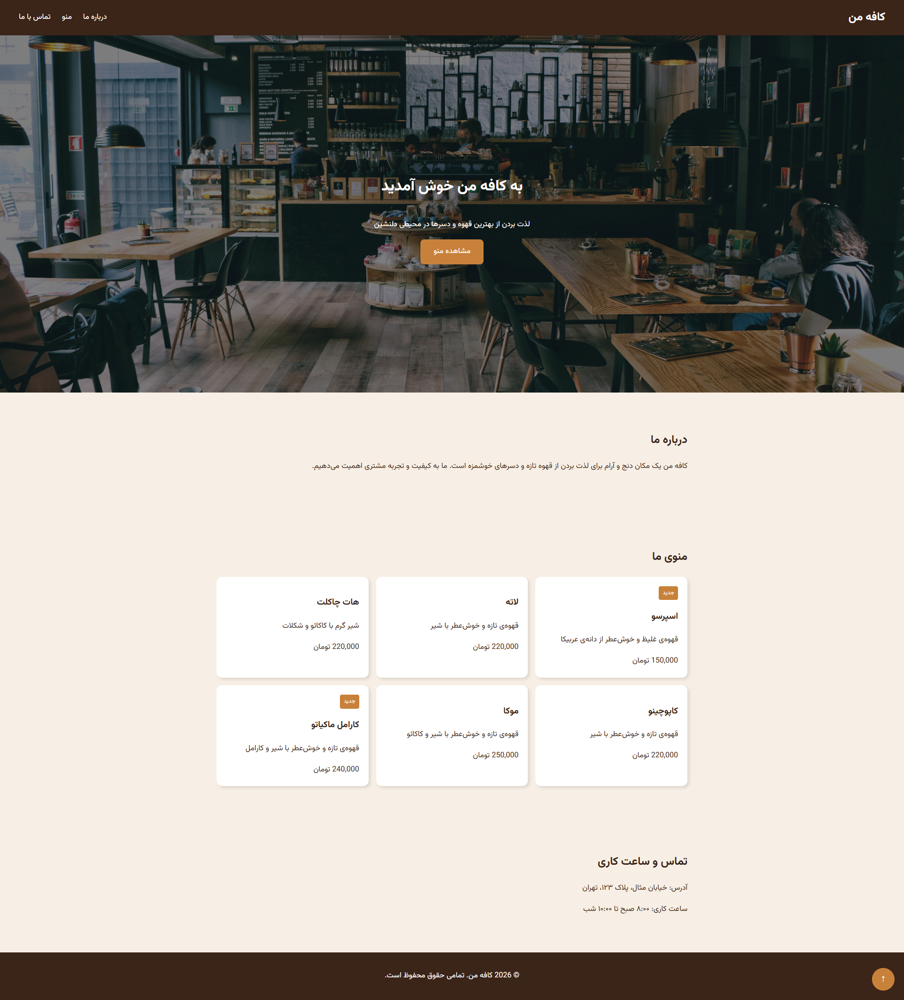

# Cafe Landing Page

A responsive landing page for a fictional cafe, built with HTML and CSS.

🔗 **Live demo:** https://arminkoliaie.github.io/cafe-landing/

## Features
- Responsive layout for mobile, tablet and desktop
- Sticky header with smooth-scroll navigation
- Menu section built with CSS Grid
- "New" badges using CSS positioning
- Back-to-top button

## What I practiced
- Semantic HTML
- Flexbox and CSS Grid
- CSS variables
- Media queries (mobile-first)
- `position`, `z-index` and `display`
- Git and GitHub Pages

## Screenshot
